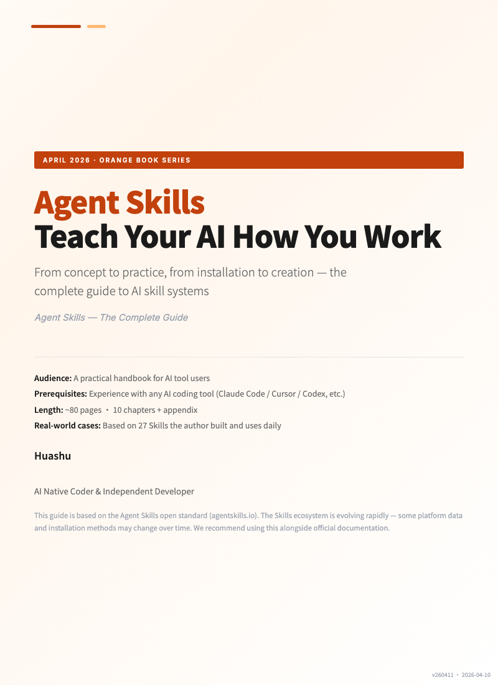
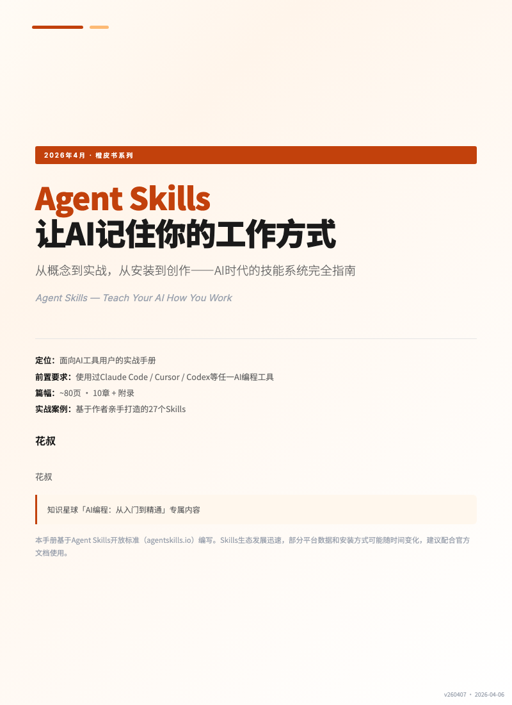

# Agent Skills: The Complete Guide

> From concept to practice, from installation to creation — the complete guide to AI skill systems.

**Agent Skills** is the open standard (agentskills.io) that lets you teach AI how you work. Instead of repeating instructions every conversation, you write a SKILL.md file once and your AI assistant remembers your workflow, preferences, and quality standards forever.

This book covers everything: what Skills are, how they work under the hood, where to find them, how to install and use them, how to create your own, and 6 advanced design patterns — including the thought-distillation pattern that emerged in 2026.

## Download

| Edition | PDF |
|---------|-----|
| English | [Agent-Skills-The-Complete-Guide-v260411.pdf](./Agent-Skills-The-Complete-Guide-v260411.pdf) |
| Chinese (中文) | [Agent-Skills-Complete-Guide-zh-v260411.pdf](./Agent-Skills-Complete-Guide-zh-v260411.pdf) |

> 💡 Download the PDF for the best reading experience. GitHub's online preview may not render properly.

## Preview

  
  

## What's Inside

**Concept (Ch 1-3)** — What Skills are, why a Markdown file can change AI behavior, the three LLM properties that make Skills work.

**Practice (Ch 4-6)** — The Skills ecosystem (7 platforms compared), installing your first Skill, triggering and chaining Skills in real workflows.

**Create (Ch 7-9)** — Building Skills from scratch, the official skill-creator tool (Create/Eval/Improve/Benchmark modes), and 6 design patterns: Checklist, Options, Pipeline, Integration, Swarm, and Distillation.

**Future (Ch 10)** — Skills as team knowledge, the Skills economy, the Distillation Universe phenomenon, and Agents creating their own Skills.

**Appendix** — Recommended Skills list, SKILL.md templates, the author's 27 Skills index, useful links, and glossary.

## About the Author

**Huashu** — AI Native Coder, independent developer, and AI content creator with 300K+ followers. Creator of Cat Ring Light (App Store paid chart #1) and the "AI Coding Orange Book" series. Built 27 production Skills and open-sourced Nuwa.skill (1,000+ GitHub stars in 2 days).

- X/Twitter: [@AlchainHust](https://x.com/AlchainHust)
- YouTube: [@Alchain](https://www.youtube.com/@Alchain)
- Bilibili: [Huashu](https://space.bilibili.com/14097567/)
- WeChat: Huashu (花叔)
- Website: [huasheng.ai](https://www.huasheng.ai/)

## Orange Book Series

This is the fourth book in the **AI Coding Orange Book** series:

1. *Claude Code: From Beginner to Master* — hands-on starter guide
2. *Claude Code: Source Code Deep Dive* — architecture analysis
3. *Harness Engineering* — methodology
4. **Agent Skills** — this book
5. *OpenClaw* — building your own AI
6. *Polymarket Guide* — prediction markets

## 📚 Read Online on WorkBuddy

This book is also available on WorkBuddy's knowledge base, one page per chapter — or just drop the link into your agent as context.

https://www.workbuddy.cn/space/d/JEdWEHCbVQDe

All orange books: https://www.workbuddy.cn/space/d/YcllWXknAUoMk6lFSWdfbI
## License

This book is provided free of charge for personal and educational use. Do not redistribute for commercial purposes without permission.
