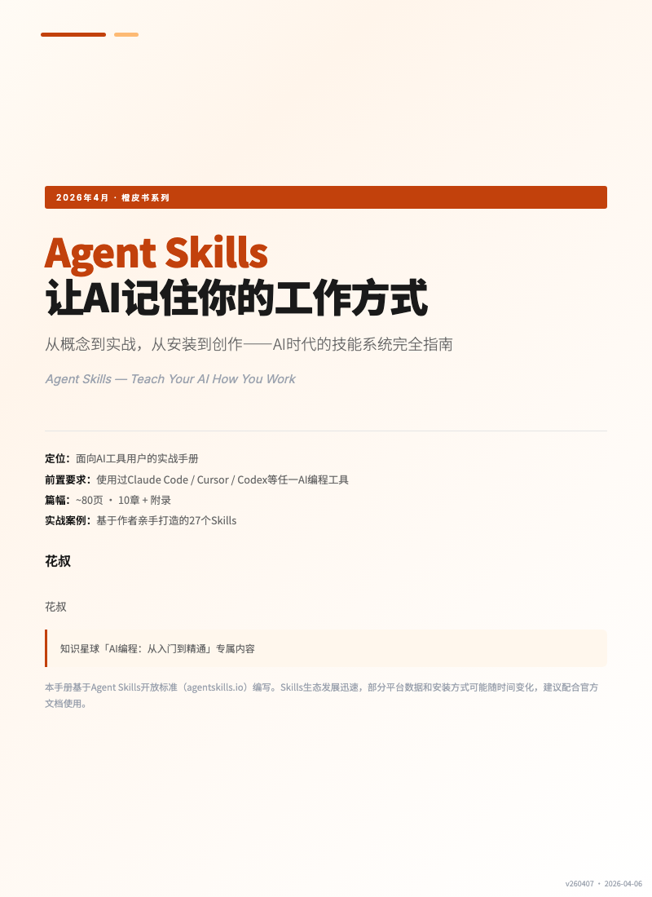
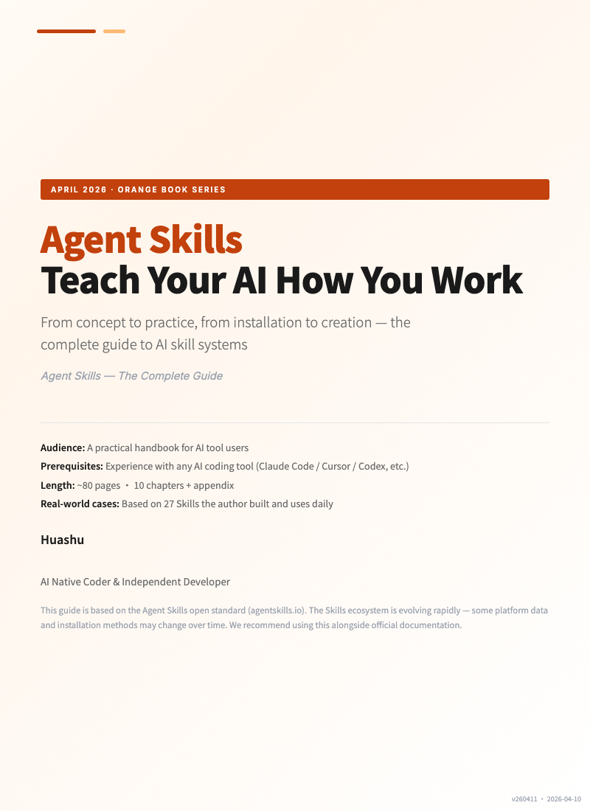

# Agent Skills 橙皮书

> 从概念到实战，从安装到创作 — AI时代的技能系统完全指南。

**Agent Skills** 是 Anthropic 发布的开放标准（agentskills.io），让你能教会 AI 按照你的方式工作。不再每次对话都重复指令，写一个 SKILL.md 文件，你的 AI 助手就能永远记住你的工作流程、审美偏好和质量标准。

这本书覆盖了所有内容：Skills 是什么、底层原理、去哪找、怎么装、怎么用、怎么自己创建，以及 6 种高级设计模式（包括 2026 年新出现的思维蒸馏型）。

## 下载

| 版本 | PDF |
|------|-----|
| 中文 | [Agent-Skills-Complete-Guide-zh-v260411.pdf](./Agent-Skills-Complete-Guide-zh-v260411.pdf) |
| English | [Agent-Skills-The-Complete-Guide-v260411.pdf](./Agent-Skills-The-Complete-Guide-v260411.pdf) |

> 💡 PDF 文件建议下载后阅读，体验更佳。GitHub 在线预览可能无法完整渲染。

## 预览

  
  

## 目录

**概念篇（第1-3章）** — Skills 是什么、为什么一个 Markdown 文件能改变 AI 的行为、让 Skills 有效的三个 LLM 特性。

**实战篇（第4-6章）** — Skills 生态全景（7个平台横向对比）、安装你的第一个 Skill、触发与串联 Skills 的实战技巧。

**创作篇（第7-9章）** — 从零创建 Skill、官方 skill-creator 工具（Create/Eval/Improve/Benchmark 四种模式）、6种设计模式：检查清单型、多方案选择型、流水线型、API集成型、多Agent协作型、思维蒸馏型。

**展望篇（第10章）** — 从个人工具到团队知识、Skills 经济、蒸馏宇宙现象、Agent 自己创建 Skills。

**附录** — 推荐 Skills 清单、SKILL.md 模板、花叔的 27 个 Skills 索引、常用链接、术语表。

## 关于作者

**花叔** — AI Native Coder，独立开发者，AI自媒体博主（30万+粉丝）。代表作：小猫补光灯（App Store 付费榜 Top1）、「AI编程橙皮书」系列。创建了 27 个生产级 Skills，开源女娲.skill（两天 GitHub star 破千）。

- X/Twitter: [@AlchainHust](https://x.com/AlchainHust)
- YouTube: [@Alchain](https://www.youtube.com/@Alchain)
- B站: [花叔](https://space.bilibili.com/14097567/)
- 公众号: 花叔
- 官网: [huasheng.ai](https://www.huasheng.ai/)

## 橙皮书系列

本书是「AI编程橙皮书」系列第四本：

1. 《Claude Code 从入门到精通》 — 实战入门手册
2. 《Claude Code 源码解析》 — 架构拆解
3. 《Harness Engineering》 — 方法论
4. **《Agent Skills》** — 本书
5. 《OpenClaw》 — 养一只你自己的 AI
6. 《Polymarket 指南》 — 预测市场

## 许可

本书免费提供，仅限个人学习使用。未经授权请勿用于商业传播。
